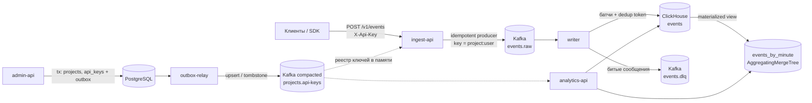

# Pulse — платформа продуктовой аналитики в реальном времени

[](https://github.com/Type-Of-Null/pulse-analytics/actions/workflows/ci.yml)

Мини-аналог Amplitude / PostHog: приём продуктовых событий по HTTP, буферизация в **Kafka**,
хранение и аналитика в **ClickHouse** (таймсерии, топ событий, воронки, retention),
управление проектами и API-ключами в **PostgreSQL**, деплой в **Kubernetes** с автомасштабированием
по consumer lag (**KEDA**).

**Стек:** Python 3.12 · FastAPI · aiokafka · clickhouse-connect · SQLAlchemy 2 (async) + asyncpg ·
Alembic · Pydantic v2 · Prometheus · structlog · Docker · Kubernetes (Kustomize, HPA, KEDA) ·
pytest + testcontainers · GitHub Actions · uv · ruff · mypy (strict)

## Архитектура



| Сервис | Роль | Масштабирование |
|---|---|---|
| `ingest-api` | Валидация, нормализация времени, публикация в Kafka. Postgres на горячем пути не используется | HPA по CPU |
| `writer` | Kafka → ClickHouse батчами, ручной commit offset'ов, DLQ, ретраи с backoff | KEDA по consumer lag (≤ числа партиций) |
| `analytics-api` | Таймсерии и топ событий по агрегатам, воронки (`windowFunnel`), retention | HPA по CPU |
| `admin-api` | Проекты и API-ключи (хранятся только SHA-256 хэши) | 1–2 реплики |
| `outbox-relay` | Transactional Outbox → compacted-топик ключей | 2 реплики, активна одна (advisory lock) |

Код организован по **гексагональной архитектуре**: `domain` (модели и правила) → `application`
(use cases, зависят только от `ports.py`) → `adapters` (Kafka, ClickHouse, Postgres) → `entrypoints`
(FastAPI, воркеры, CLI). Use cases тестируются без инфраструктуры на fake-адаптерах.

```
src/pulse/
├── domain/          # события, проекты/ключи, аналитические модели — чистый Python
├── application/     # IngestEvents, BatchWriter, AnalyticsService, ProjectService, ApiKeyRegistry
├── ports.py         # Protocol-интерфейсы: EventPublisher, EventSink, UnitOfWork, ...
├── adapters/        # kafka/ · clickhouse/ (+ SQL-миграции) · postgres/ (+ Alembic, outbox relay)
├── entrypoints/     # ingest_api, analytics_api, admin_api, workers
└── cli.py           # pulse ingest-api | writer | outbox-relay | migrate all | ...
```

## Ключевые архитектурные решения

Подробно — в [docs/adr](docs/adr).

1. **Kafka как буфер** между приёмом и хранилищем — приём не зависит от ClickHouse, запись идёт
   крупными батчами (ClickHouse не любит мелкие INSERT'ы). Ключ партиционирования `project_id:user_id`
   сохраняет порядок событий пользователя. → [ADR-0001](docs/adr/0001-kafka-as-ingestion-buffer.md)
2. **At-least-once + идемпотентная запись = эффективно exactly-once**: offset коммитится только после
   INSERT; повторный батч отсекается `insert_deduplication_token` (детерминированный хэш диапазонов
   offset'ов), дубли от ретраев клиента схлопывает `ReplacingMergeTree` по `event_id`; при ребалансе
   writer сбрасывает буфер до передачи партиции. → [ADR-0002](docs/adr/0002-at-least-once-with-idempotent-sink.md)
3. **Авторизация без БД на горячем пути**: реестр API-ключей в памяти каждого pod'а строится из
   compacted-топика Kafka; pod становится `ready` только после вычитки топика до конца.
   → [ADR-0003](docs/adr/0003-api-keys-from-compacted-topic.md)
4. **Transactional Outbox**: изменение ключа и запись в outbox — одна транзакция; relay с
   `pg_try_advisory_xact_lock` гарантирует единственного активного публикатора и порядок.
   → [ADR-0004](docs/adr/0004-transactional-outbox.md)
5. **Схема ClickHouse**: `ReplacingMergeTree` + помесячные партиции + TTL + bloom-filter индекс;
   агрегаты `uniqState` (события по `event_id`, пользователи) в `AggregatingMergeTree` через materialized view — таймсерии
   читают на порядки меньше строк. → [ADR-0005](docs/adr/0005-clickhouse-schema.md)
6. **Kubernetes**: Kustomize base/overlays/components, миграции отдельным Job'ом, KEDA по lag,
   startup/readiness/liveness probes, graceful shutdown, PDB, non-root + read-only FS, NetworkPolicy.
   → [ADR-0006](docs/adr/0006-kubernetes-deployment.md)

## Быстрый старт (Docker Compose)

```bash
make up        # Kafka (KRaft), ClickHouse, Postgres, миграции и все 5 сервисов
make e2e       # e2e-тесты против поднятого стенда
make loadgen   # генератор нагрузки: 5000 событий/с, 30 с
```

```bash
# 1. Создать проект — в ответе API-ключ (показывается один раз)
curl -s -XPOST localhost:8003/v1/projects -H 'Authorization: Bearer dev-admin-token' \
     -H 'Content-Type: application/json' -d '{"name": "shop"}'

# 2. Отправить события
curl -s -XPOST localhost:8001/v1/events -H "X-Api-Key: $KEY" -H 'Content-Type: application/json' \
     -d '{"events": [{"name": "signup", "user_id": "u1", "properties": {"plan": "pro"}}]}'
# {"accepted":1,"clamped":0}

# 3. Аналитика
curl -s "localhost:8002/v1/analytics/top-events" -H "X-Api-Key: $KEY"
curl -s "localhost:8002/v1/analytics/timeseries?event=signup&granularity=hour" -H "X-Api-Key: $KEY"
curl -s -XPOST localhost:8002/v1/analytics/funnel -H "X-Api-Key: $KEY" -H 'Content-Type: application/json' \
     -d '{"steps": ["page_view", "signup", "purchase"], "window_seconds": 3600}'
curl -s "localhost:8002/v1/analytics/retention?start_event=signup&return_event=page_view&cohort_date=$(date +%F)&days=7" -H "X-Api-Key: $KEY"
```

Swagger: http://localhost:8001/docs, http://localhost:8002/docs, http://localhost:8003/docs.
Prometheus: `docker compose --profile observability up -d prometheus` → http://localhost:9090.

## Kubernetes (kind)

```bash
make kind-up    # kind-кластер, metrics-server, KEDA, dev-overlay (инфраструктура внутри кластера)
make kind-e2e   # те же e2e-тесты через port-forward
make kind-down
```

```
deploy/k8s/
├── base/                 # Deployments, Services, HPA, PDB, NetworkPolicy, migrate Job, ConfigMap
├── components/keda/      # ScaledObject: writer по lag consumer-группы
└── overlays/
    ├── dev/              # kind: Kafka/ClickHouse/Postgres StatefulSets, 1 реплика, секреты-заглушки
    └── prod/             # managed-инфраструктура, образ ghcr.io/type-of-null/pulse-analytics
```

## Тестирование

| Уровень | Что проверяет | Команда |
|---|---|---|
| Unit | Домен и use cases на fake-адаптерах: валидация, батчинг writer'а, ретраи, DLQ, коммит offset'ов, реестр ключей, API | `make test` |
| Integration | Реальные ClickHouse и Postgres (testcontainers): миграции, дедупликация, SQL воронок/retention, outbox и advisory lock | `make test-integration` |
| E2E | Весь конвейер: ключ → outbox → Kafka → реестр → приём → writer → ClickHouse → аналитика, отзыв ключа | `make e2e`, `make kind-e2e` |
| Нагрузка | `scripts/loadgen.py`: синтетическая воронка, ~5k событий/с на ноутбуке | `make loadgen` |

CI (GitHub Actions): ruff + mypy strict → unit + integration → e2e на docker compose (+ smoke-нагрузка)
и e2e в kind-кластере с KEDA → сборка и публикация образа в GHCR (main).

## Наблюдаемость

- Prometheus-метрики на `/metrics` у каждого сервиса (у воркеров — встроенный probe-сервер):
  принятые события и коррекции clock skew, латентность публикации в Kafka, размер батча и латентность
  INSERT, ретраи, сообщения в DLQ по причинам, опубликованные outbox-записи и лидер relay, размер реестра ключей.
- Структурированные JSON-логи (structlog) с именем сервиса.

## Для резюме

> **Pulse — платформа продуктовой аналитики реального времени** (Python, FastAPI, Kafka, ClickHouse,
> PostgreSQL, Kubernetes) — github.com/Type-Of-Null/pulse-analytics
>
> - Спроектировал event-driven систему из 5 сервисов по гексагональной архитектуре: приём событий
>   через Kafka, батчевая запись в ClickHouse, аналитика (таймсерии, воронки `windowFunnel`, retention).
> - Обеспечил доставку без потерь и дублей без распределённых транзакций: ручной commit offset'ов после
>   записи, детерминированные `insert_deduplication_token`, `ReplacingMergeTree`, DLQ для невалидных сообщений.
> - Убрал PostgreSQL с горячего пути приёма: реестр API-ключей в памяти строится из compacted-топика Kafka,
>   изменения доставляются через Transactional Outbox с единственным активным relay (advisory lock).
> - Ускорил запросы таймсерий за счёт агрегатов `AggregatingMergeTree` на materialized view.
> - Развернул в Kubernetes (Kustomize): HPA для API, автомасштабирование writer'а по consumer lag через KEDA,
>   миграции Job'ом, probes, graceful shutdown, PDB, hardened security context.
> - Покрыл тестами: unit, интеграционные на testcontainers, e2e в docker compose и kind;
>   CI на GitHub Actions; нагрузочный генератор (~5k событий/с на одной машине).
